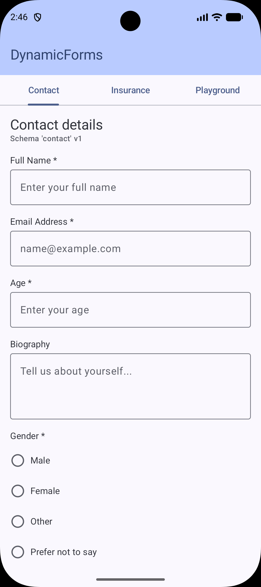
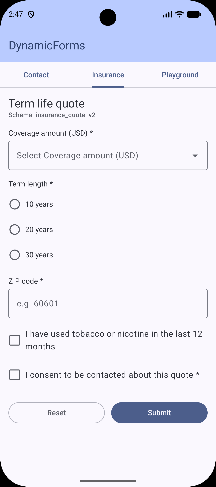
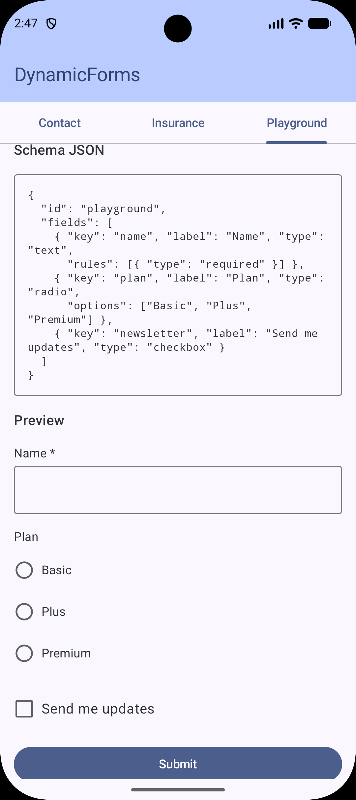

# DynamicForms

**Server-driven forms for Jetpack Compose.** Define a form in JSON, render it natively, and change it without shipping an app release.

<p>
  
  
  
</p>

## Why

In regulated domains like insurance, fintech, and healthcare, forms change all the time: new questions, new validation rules, new compliance copy. Hardcoding each form ties every change to an app release and a store review cycle.

DynamicForms moves the form definition to the backend. The app ships one renderer, and product teams update flows by changing a schema.

## Features

- 8 field types: `text`, `number`, `email`, `textarea`, `dropdown`, `radio`, `checkbox`, `date_picker`
- Declarative validation in the schema: `required`, `min_length`, `max_length`, `regex`, plus built-in number, email and option checks
- **Forward-compatible:** unknown field types, rule types and JSON properties are skipped, not fatal, so a schema written for a newer app version still renders on older installs
- **Schema validation:** duplicate keys, missing options and invalid regexes are all reported together in one `InvalidSchemaException`
- Errors appear on submit, then update live as the user fixes them
- State survives rotation and process death
- Accessibility: proper roles and semantics for checkbox, radio and selection groups
- No ViewModel or DI framework imposed on the host app

## Installation

```kotlin
// settings.gradle.kts
dependencyResolutionManagement {
    repositories { maven("https://jitpack.io") }
}

// build.gradle.kts
dependencies {
    implementation("com.github.NehaPrakashG:DynamicApp:0.1.0")
}
```

Or clone the repo and run the `app` module to try the sample.

## Usage

**1. Define the form (served from your backend):**

```json
{
  "id": "contact_v1",
  "version": 1,
  "fields": [
    { "key": "full_name", "label": "Full Name", "type": "text",
      "rules": [{ "type": "required" }, { "type": "min_length", "length": 2 }] },
    { "key": "email", "label": "Email", "type": "email",
      "rules": [{ "type": "required" },
                { "type": "max_length", "length": 100 }] },
    { "key": "country", "label": "Country", "type": "dropdown",
      "options": ["United States", "Canada", "India"] },
    { "key": "terms", "label": "I agree to the terms", "type": "checkbox",
      "rules": [{ "type": "required" }] }
  ]
}
```

**2. Render it:**

```kotlin
val schema = FormSchema.fromJson(json)

DynamicForm(
    schema = schema,
    onSubmit = { values -> repository.submit(values) }
)
```

`values` is a `Map<String, Any>` keyed by each field's `key`, in schema order: `Boolean` for checkboxes, `String` for everything else. `onSubmit` is only called once every field is valid.

`FormSchema.fromJson` throws `InvalidSchemaException` (with a `problems` list) if the JSON is malformed or the schema is inconsistent.

**3. Control the form from outside (optional):**

```kotlin
val formState = rememberDynamicFormState(schema)

DynamicForm(state = formState, onSubmit = ::submit, submitLabel = null)

OutlinedButton(onClick = formState::reset) { Text("Reset") }
Button(onClick = { if (formState.validate()) submit(formState.values()) }) { Text("Continue") }
```

## Sample app

The `app` module has three tabs:

- **Contact:** a general form loaded from `assets/forms/contact.json`
- **Insurance:** a quote form whose schema includes a `signature_pad` field this version doesn't support; it's skipped instead of breaking the form
- **Playground:** edit schema JSON and watch the form re-render, with schema errors shown as you type

## Architecture

```
JSON ──► FormSchema.fromJson ──► FormSchema (immutable definition)
             │                       │
   wire DTOs + SchemaValidator       ▼
                              FormState (pure Kotlin snapshot)
                                     ▲  reducers: withText / withChecked / validateAll / reset
                                     │
                              DynamicFormState (Compose holder, rememberSaveable)
                                     │
                                     ▼
                              DynamicForm() ──► DynamicFieldRenderer (per field type)
```

- **Schema vs. state:** the definition is immutable and has no user input. Values and errors live in `FormState`.
- **Pure core:** all parsing, validation and state transitions are plain Kotlin with no Android dependency, unit-tested on the JVM.
- **Wire format is internal:** JSON is decoded into internal DTOs and mapped to the public model, so the JSON shape can evolve without breaking the API.
- **UDF:** the UI only emits events; every state change goes through a pure reducer.
- **Minimal public API:** `explicitApi()` is on, and renderers are internal.

## Testing

```bash
./gradlew :dynamicforms:testDebugUnitTest   # schema parsing, validation, state transitions
```

## AI-Assisted Workflow

I designed the architecture and used AI tools (Claude, Copilot) to speed up implementation. I reviewed every change, tested it, and owned the result. Some places where I overrode the AI's output:

| AI suggestion | My decision | Why |
|---|---|---|
| <!-- TODO: replace with your real example --> Single model holding both field definition and runtime value | Split into `FormSchema` + `DynamicFormState` | Schema must be serializable and immutable; mixing state blocks server-driven use |
| <!-- TODO --> Library ships a `ViewModel` with hardcoded fields | Expose a Compose state holder instead | A library shouldn't force its host app's architecture |
| <!-- TODO --> Regex rule recompiled on every keystroke | Compile once per rule | Avoid needless allocation during typing |

**Where I didn't use AI:** <!-- TODO: e.g. API surface design, accessibility semantics, test cases for edge conditions -->

## Roadmap

- [ ] Custom field renderers for app-specific types
- [ ] Compose UI tests
- [ ] Conditional visibility (show field B when A = X)
- [ ] Multi-step forms
- [ ] Schema versioning and migration
- [ ] Publish to Maven Central

## License

Apache 2.0
